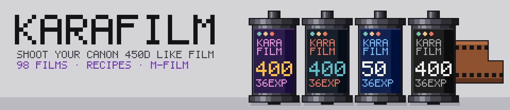
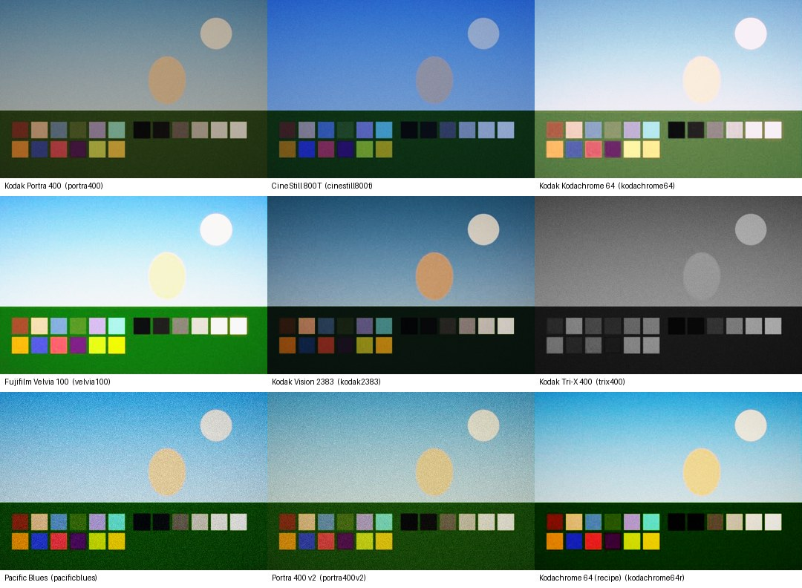
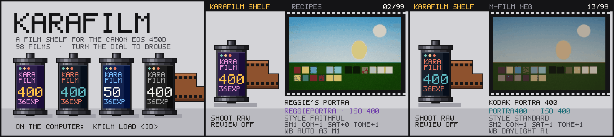
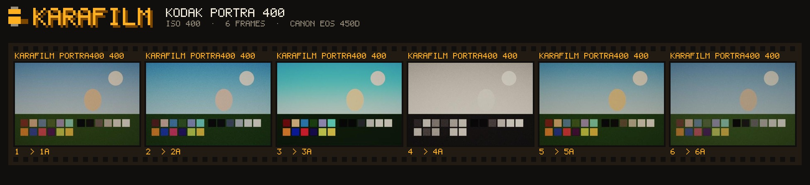

# Karafilm 🎞️

*(the project is `k-film`, the command is `kfilm`)*

**Shoot your Canon EOS 450D (Rebel XSi / Kiss X2) like a film camera.**

Load a roll, shoot without looking at the screen, then develop the whole roll
at once into film prints and a contact sheet. Pick from **98 films**:

- **26 K-Film films**, among them 9 popular Fujifilm recipes (Summer Chrome,
  Reggie's Portra, Pacific Blues, Kodachrome 64...) with 450D camera settings
- **all 72 films of [M-Film](https://github.com/HNGSeries/mfilm-canon-film-simulation)**,
  developed with M-Film's own film model and the Film-Luts colours
- rolls that **M-Film's Darkrooms app can open**, straight from a 450D card



## Why the 450D needs this

M-Film turns newer Canons (500D, 550D, 650D...) into film cameras by running
Magic Lantern inside the camera. The 450D is older (DIGIC III, VxWorks), so
M-Film can't run on it ([why](docs/PORTING-450D.md)).
**Never copy an M-Film camera zip onto a 450D card**: it is built for one
other camera and firmware.

K-Film does the film part on your computer instead. Your camera is never
changed. The camera just shoots RAW, the "roll" is a small file on the SD
card, and the darkroom runs on your Mac or PC.

## How it works

| Step | Film camera | K-Film |
|---|---|---|
| 1 | Pick a film, load it | `kfilm load portra400` |
| 2 | Set the ISO from the box | set the 450D to the ISO it tells you |
| 3 | Shoot, no preview | Quality **RAW**, Review time **Off** |
| 4 | Rewind (realistic mode) | `kfilm rewind` |
| 5 | Develop at the lab | `kfilm develop` (prints + contact sheet) or open **Darkrooms** |

Everything on the card from before you loaded the roll is ignored. RAW+JPEG
pairs count as one frame, and shots after the roll ran out aren't developed.
With one card in, K-Film finds it by itself; otherwise add `--card /Volumes/EOS_DIGITAL`.

## Install

Requires Python 3.10+.

```bash
git clone https://github.com/KristLaw/k-film.git
cd k-film
pip install .
kfilm getluts        # once: the colours for the M-Film films (~40 MB)
```

## The shelf on the camera

M-Film shows a film shelf on the camera screen. The 450D can't run M-Film,
but it can show photos, so Karafilm puts the shelf on the card **as photos**:
one pixel-art page per film, with its canister, a sample print and what to
set on the 450D. Press **PLAY** and turn the dial.



They are `DCIM/100CANON/KFLM0001.JPG` to `KFLM0099.JPG`: proper Canon
DCF files (Exif, 160×120 thumbnail, 2256×1504 like the 450D's S size), with
low numbers so your camera's own file numbers carry on after your photos.
Karafilm never counts them as frames of a roll. With an M-Film camera folder
on the computer (e.g. `/Applications/M-Film-camera-550D.109`), the M-Film
films' pages use M-Film's own sample photos; otherwise the test chart.

## The card folder

Like M-Film's card zip, Karafilm has a folder for the SD card. The 450D can't
run programs from a card, so it holds no program: it carries the shelf pages
above, the 450D settings for every film and a short guide, and keeps the
loaded roll.

```
DCIM/100CANON/KFLM*.JPG   the shelf for the camera's Playback
KFILM/
  README.TXT      how to shoot a roll
  FILMS.TXT       every film: ISO + Picture Style + WB for the 450D
  SHELF.PNG       all 98 canisters on one page
  SHELF/*.PNG     one canister per film
  ROLL.JSON       the loaded roll (kfilm load)
```

`kfilm card` puts it on the card (`kfilm load` does too, the first time),
or download **K-Film-card-450D.zip** from the
[releases](https://github.com/KristLaw/k-film/releases) and unzip it at the
top of the card, next to `DCIM`. The camera ignores it. Formatting the card
in the camera erases it: run `kfilm card` again.

## Quick start

```bash
kfilm films                       # all 98 films
kfilm films --shelf recipes       # just the Fujifilm-recipe looks
kfilm load reggieportra --frames 24
# ...shoot 24 frames on the 450D...
kfilm status                      # 24/24 exposed
kfilm develop --size large        # prints land in KFILM/PRINTS on the card
```

### Camera settings (450D)

- **Quality:** RAW (or RAW+L). The darkroom develops the RAW.
- **Review time:** Off (Shooting menu 1). This is what makes it feel like film.
- **ISO:** what `kfilm load` prints. Push +1 → ISO doubles. (The 450D goes
  100–1600, 3200 as "H"; for ISO 25–64 films K-Film tells you the exposure comp.)
- **Picture Style + white balance:** they don't change the RAW, but they make
  the camera's own preview look like the film. `kfilm camera portra400` (and
  `kfilm load`) says what to set: M-Film's in-camera settings for its films,
  the recipe cards for the recipes. The 450D has no Kelvin white balance, so
  K-Film gives Daylight or Tungsten instead.
- **Firmware:** any. K-Film never touches the camera.

Every roll ends with a contact sheet in K-Film's pixel style:



## Develop with Darkrooms (M-Film's app)

Every roll also writes `DCIM/100CANON/ROLL_nnn.TXT`, the same roll log an
M-Film camera writes, so **Darkrooms** shows your 450D rolls on its shelf.
Run `kfilm status` (or `kfilm sync`) after shooting so the log lists the new
frames, then open Darkrooms with the card in. Details: [docs/DARKROOMS.md](docs/DARKROOMS.md).

## Films

| Shelf | Films |
|---|---|
| **Recipes** (Fujifilm recipes → 450D) | `summerchrome` · `leicax` · `fuji200` · `reggieportra` · `nostalgicneg` · `kodachrome64r` · `cinestill800tr` · `pacificblues` · `portra400v2` |
| **K-Film** colour | `studio160` · `studio400` · `sun200` · `street400` · `city400` · `pastel400` · `cine800t` · `cine50d` |
| **K-Film** slide / B&W | `vivid50` · `true100` · `chrome100` · `grit400` · `soft400` · `fine100` · `red25` · `night3200` · `sepia200` |
| **M-Film** (72) | `portra400` · `cinestill800t` · `ektar100` · `gold200` · `superia400` · `velvia50` · `hp5` · `trix400` · `kodachrome64` · `kodak2383` · ... (`kfilm films`) |

Recipe settings, their creators and sources: [docs/RECIPES.md](docs/RECIPES.md).

### Extras

```bash
kfilm load trix400 --push 1           # shoot at 800, push-process
kfilm develop --film velvia50         # cross-process into another film
kfilm load portra400 --mode realistic # rewind before developing; `kfilm open-back` = light leaks
kfilm print kodak2383 IMG_0042.CR2    # one-off print, no roll
kfilm hald --out my_look.png          # neutral HaldCLUT to grade your own look
kfilm develop --lut my_look.png
```

The old `xsi` command still works, and cards with an XSi Darkroom 0.1 roll
(`XSIROLL/`) are read as before.

## Project layout

```
kfilm/
  films.py          one shelf for every film (both engines)
  stocks.py         K-Film films and recipe translations
  process.py        RAW decode (LibRaw via rawpy) + K-Film engine
  mfilm.py          M-Film's lab model, ported to numpy
  mfilm_films.py    M-Film's film list (from M-Film, GPL-2.0)
  mfilm_filmluts.py the 63 Film-Luts films (from M-Film)
  lut.py            .cube LUT reader (from M-Film)
  darkrooms.py      roll logs for Darkrooms, EXIF reader
  camera450d.py     what to dial into the 450D for each film
  pixelfont.py      the 5x7 pixel font (drawn in code)
  art.py            Karafilm pixel art: canisters, camera shelf pages
  dcf.py            Canon-style JPEGs the 450D can play back
  cardkit.py        the card folder and camera shelf
  roll.py · card.py · contact.py · hald.py · cli.py
tools/make_images.py   rebuilds the README pictures
docs/  RECIPES.md · DARKROOMS.md · PORTING-450D.md
```

## Roadmap

- [x] Roll workflow, contact sheet, push/pull, HaldCLUT
- [x] 9 Fujifilm recipes + 450D in-camera cards
- [x] M-Film's 72 films and Darkrooms rolls
- [ ] Tune the films on real 450D CR2s (sample rolls welcome!)
- [ ] A simple app window (drag in the card, pick a film)
- [ ] Printable film-box cards for the camera's back

## Credits & licence

GPL-2.0 ([LICENSE](LICENSE)), because K-Film includes code and film data from
**M-Film** by HNGSeries (GPL-2.0). Film colours: **Film-Luts** by Yahia Angelo
(MIT), downloaded by `kfilm getluts`, not shipped here. RAW decoding:
[LibRaw](https://www.libraw.org/) through [rawpy](https://github.com/letmaik/rawpy).
See [THIRD_PARTY.md](THIRD_PARTY.md).

Recipe names belong to their creators. Film names describe a look; they are
trademarks of their owners. Not affiliated with Canon, Kodak, Fujifilm,
Ilford, CineStill or the M-Film project.
