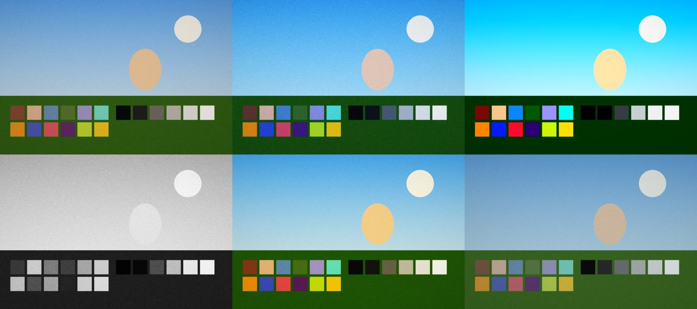

# XSi Darkroom 🎞️

**Shoot your Canon EOS 450D (Rebel XSi / Kiss X2) like a film camera.**

Load a roll of film, shoot without looking at the screen, then develop the
whole roll at once into film-look prints and a contact sheet.

Inspired by [M-Film](https://github.com/HNGSeries/mfilm-canon-film-simulation),
which does this *inside* the camera on Magic Lantern bodies. The 450D can't
run M-Film (see [why](docs/PORTING-450D.md)), so XSi Darkroom does the same
idea from your computer: the camera shoots RAW, the "roll" lives as a small
file on the SD card, and the darkroom runs on your PC.


## How it works

| Step | Film camera | XSi Darkroom |
|---|---|---|
| 1 | Pick a film, load it | `xsi load studio400 --card E:\` |
| 2 | Set the ISO from the box | Set the 450D to the ISO it tells you |
| 3 | Shoot 36 frames, no preview | Shoot RAW with **Review time: Off** |
| 4 | Rewind (realistic mode) | `xsi rewind --card E:\` |
| 5 | Develop at the lab | `xsi develop --card E:\` → prints + contact sheet |

Everything you shot before loading the roll is ignored, RAW+JPEG pairs count
as one frame, and shots taken after the roll ran out are not developed.

## Install

Requires Python 3.9+.

```bash
git clone https://github.com/KristLaw/xsi-darkroom.git
cd xsi-darkroom
pip install .
```

## Quick start

```bash
xsi stocks                                  # list the 22 film stocks
xsi load cine800t --card /Volumes/EOS_DIGITAL --frames 24
# ...go shoot 24 frames on the 450D...
xsi status  --card /Volumes/EOS_DIGITAL     # 24/24 exposed
xsi develop --card /Volumes/EOS_DIGITAL --size large
```

Prints land in `XSIROLL/PRINTS/` on the card (or `--out somewhere`).

### Camera settings (450D)

- **Quality:** RAW (or RAW+L). The darkroom uses the RAW.
- **Review time:** Off (Shooting menu 1). This is what makes it feel like film.
- **ISO:** what `xsi load` prints. Push +1 → ISO doubles.
- **Picture Style:** anything; it does not affect RAW development.
- **Firmware:** any. XSi Darkroom never touches the camera.

### Modes

- `--mode basic`: the roll is done when you hit the last frame.
- `--mode realistic`: you must `xsi rewind` before developing. `xsi open-back`
  simulates opening the back mid-roll: the last frames get light leaks.
  Loading a new roll over an unrewound one ruins it.

### Extras

```bash
xsi load grit400 --card E:\ --push 1      # shoot Tri-X style at 800, push-process
xsi develop --card E:\ --stock vivid50    # cross-process into a different stock
xsi print studio160 IMG_0042.CR2          # one-off print, no roll
xsi hald --out my_look.png                # neutral HaldCLUT to grade yourself
xsi develop --card E:\ --lut my_look.png  # apply a HaldCLUT after the film curve
```

## Film stocks

| Colour negative | Slide | Black & white |
|---|---|---|
| `studio160` · `studio400` · `sun200` · `street400` · `city400` · `pastel400` · `cine800t` · `cine50d` | `vivid50` · `true100` · `chrome100` | `grit400` · `soft400` · `fine100` · `red25` · `night3200` · `sepia200` |

**Community recipes** (translated from popular Fujifilm recipes, with 450D in-camera
settings too): `summerchrome` · `leicax` · `fuji200` · `reggieportra` · `nostalgicneg`.
See [docs/RECIPES.md](docs/RECIPES.md).

Each stock is an original parametric model (tone curve, colour crossover,
saturation, fade, split tone, grain, halation) in
[`xsi_darkroom/stocks.py`](xsi_darkroom/stocks.py). They aim for the general
character of famous films, not an exact match. Add your own by adding a
`FilmStock(...)` line. Pull requests with new stocks are welcome.


*Test chart: Studio 400, Cine 800T, Vivid 50 / Grit 400, Sun 200, Pastel 400.*

## Project layout

```
xsi_darkroom/
  stocks.py    film stock models
  process.py   RAW decode (LibRaw via rawpy) + film pipeline
  roll.py      roll state on the SD card (XSIROLL/ROLL.JSON)
  contact.py   contact sheets, light leaks
  hald.py      optional HaldCLUT support
  cli.py       the `xsi` command
docs/PORTING-450D.md   research: running M-Film inside the 450D
docs/RECIPES.md        film recipes + 450D camera settings
tests/                 pytest suite
```

## Roadmap

- [x] Roll workflow, 17 stocks, contact sheet, push/pull, HaldCLUT
- [x] 5 community recipes + 450D in-camera cards ([docs/RECIPES.md](docs/RECIPES.md))
- [ ] Tune stocks against real 450D CR2 files (needs sample rolls!)
- [ ] Simple GUI (drag in the card, pick a stock)
- [ ] Printable film-box cards for the camera's back
- [ ] Research: in-camera port, see [docs/PORTING-450D.md](docs/PORTING-450D.md)

## Credits & licence

MIT licence, see [LICENSE](LICENSE). Written from scratch; no code from M-Film
or Magic Lantern is included. RAW decoding by [LibRaw](https://www.libraw.org/)
through [rawpy](https://github.com/letmaik/rawpy).

Not affiliated with Canon, Kodak, Fujifilm, Ilford, CineStill or the M-Film
project. Film names in `inspired_by` describe a look; they are trademarks of
their owners.
