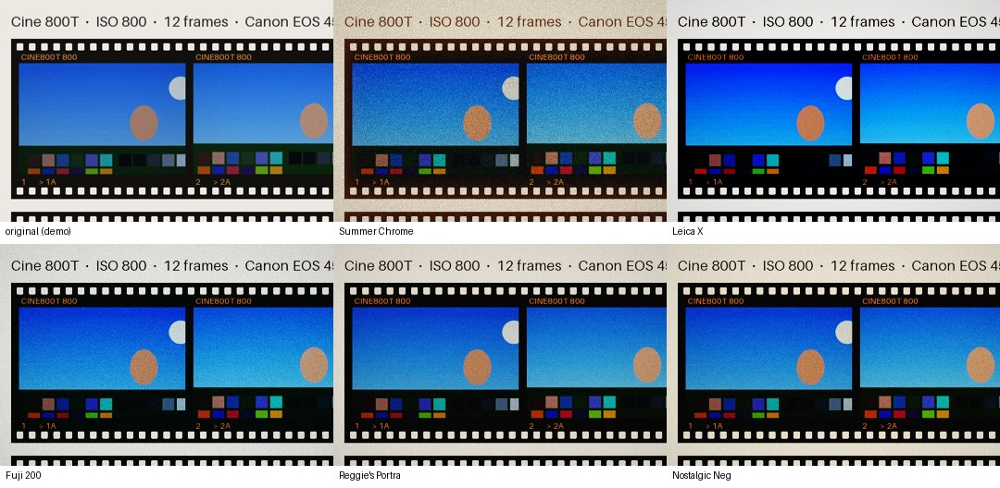

# Film recipes for the 450D

Popular Fujifilm "recipes" are lists of in-camera JPEG settings that make a
look. The 450D has no Fujifilm settings, so each recipe here comes two ways:

1. **On the computer (best):** shoot RAW, develop with the stock id, e.g.
   `kfilm load summerchrome`.
2. **In the camera (JPEG):** a Picture Style + White Balance Shift card you
   dial into the 450D. Quick, but a rough approximation.

All translations are by eye. They aim for the recipe's general feeling, not
an exact match. Please send test shots so they can be tuned.

## How the translation works

| Fujifilm setting | What it does | 450D in-camera equivalent | K-Film parameter |
|---|---|---|---|
| Film Simulation | base colour | Picture Style base (Standard / Neutral / Faithful) | `crossover`, `saturation` |
| White Balance shift (Red +, Blue −) | warmer/cooler | **WB-SHIFT/BKT**: Blue −N ≈ **A** (amber), Red +N ≈ a little **M** | `gain` |
| Highlight / Shadow (−) | flatter, softer | Picture Style **Contrast −** | `contrast`, `latitude` |
| Dynamic Range DR400 | holds highlights | **Highlight Tone Priority** (C.Fn, ISO 200+) | `latitude` |
| Color (+) | more saturation | **Saturation +** | `saturation` |
| Grain Effect | film grain | none in camera | `grain`, `grain_size` |
| Sharpness / Clarity | crispness | **Sharpness** (0–7) | (not modelled) |

Rough rule for the WB shift: Fuji Blue −N → about A(N×0.8); Fuji Red +N →
about M(N×0.3). Picture Style values on the 450D go −4…+4 (Sharpness 0…7).

---

## 1. Summer Chrome → `summerchrome`
*By Osan Bilgi. Warm, golden, cinematic, nostalgic.*

| Fujifilm original | |
|---|---|
| Film Simulation | Classic Chrome |
| Grain | Strong, Large |
| Color Chrome Effect / FX Blue | Strong / Strong |
| White Balance | Auto, R +5, B −6 |
| Dynamic Range | DR400 |
| Highlight / Shadow | −2 / −2 |
| Color | +4 |
| Sharpness / NR / Clarity | 0 / −4 / −4 |
| Exposure comp. | 0 to +1 |

**450D card:** Picture Style **User Def. 1** = Neutral, Sharpness 2,
Contrast −2, Saturation +2, Color tone 0 · WB **AWB**, shift **A5 M2** ·
Highlight Tone Priority **On** · Exp. comp **+⅓ to +⅔** · ISO 400.

## 2. Leica X → `leicax`
*By Carl Cruz. Crisp, clean, bold, cooler; city and everyday.*

| Fujifilm original | |
|---|---|
| Film Simulation | Classic Chrome |
| Grain | Off |
| Color Chrome Effect / FX Blue | Strong / Strong |
| White Balance | Auto, R +1, B −2 |
| Dynamic Range | Auto |
| Highlight / Shadow | −1 / 0 |
| Color | +4 |
| Sharpness / NR / Clarity | 0 / −4 / 0 |

**450D card:** Picture Style **User Def. 2** = Standard, Sharpness 3,
Contrast +1, Saturation +1, Color tone 0 · WB **AWB**, shift **A1** ·
Exp. comp **0** · ISO 100–200.

## 3. Fuji 200 (Fujicolor C200) → `fuji200`
*By Fuji X Weekly. Cheap Fuji colour negative; greenish shadows.*

| Fujifilm original | |
|---|---|
| Film Simulation | Classic Negative |
| Grain | Weak, Large |
| Color Chrome Effect / FX Blue | Weak / Off |
| White Balance | Daylight, R 0, B −3 |
| Dynamic Range | DR400 (DR200 in flat light) |
| Highlight / Shadow | +0.5 / −0.5 |
| Color | +2 |
| Sharpness / NR / Clarity | −3 / −4 / −3 |
| Exposure comp. | 0 to +⅔ |

**450D card:** Picture Style **User Def. 3** = Standard, Sharpness 1,
Contrast +1, Saturation 0, Color tone −1 · WB **Daylight**, shift **A2 G1** ·
Highlight Tone Priority **On** · Exp. comp **+⅓** · ISO 200.

## 4. Reggie's Portra (Portra 400) → `reggieportra`
*By Reggie Ballesteros. Warm Portra-style skin; the most popular recipe of 2025.*

| Fujifilm original | |
|---|---|
| Film Simulation | Classic Chrome |
| Grain | Weak, Small |
| Color Chrome Effect / FX Blue | Strong / Weak |
| White Balance | Auto, R +2, B −4 |
| Dynamic Range | DR-Auto |
| Highlight / Shadow | −1 / −1 |
| Color | +2 |
| Sharpness / NR / Clarity | −2 / −4 / 0 |
| Exposure comp. | about +⅓ to +1 |

**450D card:** Picture Style = Faithful, Sharpness 1, Contrast −1,
Saturation 0, Color tone +1 · WB **AWB**, shift **A3 M1** · Exp. comp
**+⅓ to +⅔** · ISO 400.

## 5. Nostalgic Neg → `nostalgicneg`
*Fujifilm's Nostalgic Neg. film simulation (1970s American colour prints),
using the "AV Americana" recipe by AV Schofield. Amber highlights, gritty.*

| Fujifilm original | |
|---|---|
| Film Simulation | Nostalgic Neg. |
| Grain | Weak, Small |
| Color Chrome Effect / FX Blue | Strong / Off |
| White Balance | Auto, R +3, B −3 |
| Dynamic Range | DR400 |
| Highlight / Shadow | −2 / −1 |
| Color | 0 |
| Sharpness / NR / Clarity | +3 / 0 / +2 |

**450D card:** Picture Style = Standard, Sharpness 5, Contrast −1,
Saturation +1, Color tone +1 · WB **AWB**, shift **A3 M1** · Highlight Tone
Priority **On** · ISO 400.

## 6. Ronan's Neg: not added yet
No published source for a recipe called "Ronan's Neg" could be found
(November 2026). If you have the link or the settings, open an issue and it
will be added here and as a stock.

## 7. Kodachrome 64 → `kodachrome64r`
*By Fuji X Weekly, its most-viewed recipe. Punchy, warm, deep shadows.*
(For M-Film's Kodachrome 64 LUT film, use `kodachrome64`.)

| Fujifilm original (X-Trans V) | |
|---|---|
| Film Simulation | Classic Chrome |
| Grain | Weak, Small |
| Color Chrome Effect / FX Blue | Strong / Off |
| White Balance | Daylight, R +2, B −5 |
| Dynamic Range | DR200 |
| Highlight / Shadow | 0 / +0.5 |
| Color | +2 |
| Sharpness / NR / Clarity | +1 / −4 / +3 |
| Exposure comp. | 0 to +⅔ |

**450D card:** Picture Style = Standard, Sharpness 4, Contrast +1,
Saturation +1, Color tone 0 · WB **Daylight**, shift **A4 M1** · ISO 100.

## 8. CineStill 800T → `cinestill800tr`
*By Fuji X Weekly. Cool teal nights, glowing lights.*
(For M-Film's CineStill 800T film, use `cinestill800t`.)

| Fujifilm original (X-Trans V) | |
|---|---|
| Film Simulation | Eterna |
| Grain | Strong, Large |
| Color Chrome Effect / FX Blue | Strong / Weak |
| White Balance | Fluorescent 3, R −6, B −4 |
| Dynamic Range | DR400 |
| Highlight / Shadow | 0 / +2 |
| Color | +4 |
| Sharpness / NR / Clarity | −3 / −4 / −5 |
| Exposure comp. | −⅓ to +⅔ |

**450D card:** Picture Style = Neutral, Sharpness 1, Contrast 0,
Saturation +2, Color tone 0 · WB **Tungsten** (outdoors at night), shift
**B2 G1** · Highlight Tone Priority **On** · ISO 800–1600.

## 9. Pacific Blues → `pacificblues`
*By Fuji X Weekly, after Lucy Laucht's "Positano Blues". Deep blue sea and sky.*

| Fujifilm original (X-Trans V) | |
|---|---|
| Film Simulation | Classic Negative |
| Grain | Strong, Large |
| Color Chrome Effect / FX Blue | Strong / Weak |
| White Balance | 5800K, R +1, B −3 |
| Dynamic Range | DR400 |
| Highlight / Shadow | −2 / +3 |
| Color | +4 |
| Sharpness / NR / Clarity | −2 / −4 / −3 |
| Exposure comp. | +⅔ to +1 |

**450D card:** Picture Style = Standard, Sharpness 2, Contrast +1,
Saturation +2, Color tone 0 · WB **Daylight** (the 450D has no Kelvin setting), shift **A2** ·
Highlight Tone Priority **On** · Exp. comp **+⅔** · ISO 200–400.

## 10. Kodak Portra 400 v2 → `portra400v2`
*By Fuji X Weekly (with Julien Jarry). Portra leaning yellow-green.*
(For M-Film's Portra 400 film, use `portra400`.)

| Fujifilm original (X-Trans V) | |
|---|---|
| Film Simulation | Classic Chrome |
| Grain | Strong, Small |
| Color Chrome Effect / FX Blue | Strong / Off |
| White Balance | 5200K, R +1, B −6 |
| Dynamic Range | DR400 |
| Highlight / Shadow | 0 / −2 |
| Color | +2 |
| Sharpness / NR / Clarity | −2 / −4 / −2 |
| Exposure comp. | +⅓ to +1 |

**450D card:** Picture Style = Faithful, Sharpness 1, Contrast −1,
Saturation 0, Color tone +1 · WB **Daylight** (≈5200 K), shift **A5 G1** · Highlight
Tone Priority **On** · Exp. comp **+⅔** · ISO 400.

---

## Sources
- Summer Chrome & Leica X: https://studioroldan.com/blog/2025/8/20/npp4jpbbk7qwwa370ilu4x8mn3hjmx
- Summer Chrome: https://filmsimrecipes.com/project/summer-chrome/
- Fujicolor C200: https://fujixweekly.com/2021/05/13/fujifilm-x-trans-iv-film-simulation-recipe-fujicolor-c200/
- Reggie's Portra: https://fujixweekly.com/2022/06/11/fujifilm-x-trans-iv-film-simulation-recipe-reggies-portra/
- Kodachrome 64: https://fujixweekly.com/2022/11/28/kodachrome-64-fujifilm-x-t5-x-trans-v-film-simulation-recipe
- CineStill 800T: https://fujixweekly.com/2024/04/16/cinestill-800t-fujifilm-x-trans-v-film-simulation-recipe/
- Pacific Blues: https://fujixweekly.com/2022/12/06/pacific-blues-fujifilm-x-t5-x-trans-v-film-simulation-recipe/
- Kodak Portra 400 v2: https://fujixweekly.com/2022/12/16/kodak-portra-400-v2-fujifilm-x-t5-x-trans-v-film-simulation-recipe/
- Nostalgic Neg. / AV Americana: https://www.fujifilm-x.com/fr-ca/stories/nostalgic-neg-fs-recipe-x-av-schofield/

Recipe names belong to their creators; credit them when you share photos.
